# TimeCraft – Industry-Level Watch E-Commerce Platform

## 1. Project Overview
**TimeCraft** is a production-oriented, single-category luxury watch e-commerce website and business administration platform built as a **Modular Monolith** with **Java 21**, **Spring Boot 3.4**, **MySQL 8**, **Flyway**, **Spring Security** (dual filter chains), **Redis**, **Cloudinary**, **Razorpay**, **OpenPDF**, **Swagger / OpenAPI 3**, **Thymeleaf** (Admin Atelier Dashboard), and a responsive **HTML5 / CSS3 / JavaScript / Bootstrap 5** customer storefront.

### Strict Two-Role Access Model
There are **ONLY TWO roles** in the entire application, enforced by a SQL `CHECK (name IN ('CUSTOMER', 'ADMIN'))` constraint in `V1__users_and_authentication.sql`:
1. `CUSTOMER` – Registers and shops on the storefront; authenticates against `/api/v1/**` via short-lived JWT access tokens and rotating SHA-256-hashed refresh tokens.
2. `ADMIN` – Has full administrative access to the business; authenticates against `/admin/**` and `/api/v1/admin/**` via a separate stateful HTTP session security filter chain with CSRF protection. There is **no** `SUPER_ADMIN` role and **no** public admin registration endpoint anywhere.

---

## 2. Features

### Customer Storefront (32 Pages)
- Customer registration, login, logout, email verification, forgot/reset password, JWT access token + rotating refresh token with reuse detection.
- Profile management, password change, in-app notifications, and Indian/international delivery address book with default address selection.
- Watch discovery: full-text search across name, brand, model reference, SKU and description; combinable filters (brand, category, price range, movement type, case diameter, strap material, dial color, water resistance, in-stock availability, discount %, rating); sorting (featured, newest, popularity, price low-to-high, price high-to-low, highest rated, discount) and pagination.
- Watch comparison tray (side-by-side comparison of up to 4 timepieces) and browser-persisted recently viewed watches.
- Unified guest + customer shopping cart (`X-Guest-Token` header automatically merges into the customer cart on login/registration), server-calculated prices, coupon validation, configurable GST breakdown, and wishlist with move-to-cart.
- Transactional checkout with pessimistic variant stock locking (`SELECT ... FOR UPDATE`), expiring stock reservations, immutable historical `order_items` snapshots, Razorpay order creation, backend HMAC-SHA256 payment signature verification, idempotent webhook processing, PDF tax invoice download, order cancellation, shipment tracking timeline, verified-purchaser reviews, and return/refund requests.

### Admin Atelier Dashboard (23 Thymeleaf Pages + `/api/v1/admin/**` REST API)
- Executive KPI dashboard (total customers, products, orders, revenue, pending/completed/cancelled orders, low-stock alerts, recent orders/customers, best-selling watches, 14-day sales & revenue trend).
- Full CRUD & management for Customers, Brands/Maisons, Categories, Watches, Variants, Cloudinary Images, Variant Inventory & Ledger Transactions, Orders & Validated Status Transitions, Razorpay Payments, Refunds, Coupons, Shipments & Tracking Events, Review Moderation, Return Requests, Customer Support Tickets, Date-filtered SQL Aggregated Reports, Audit Logs, and Store Settings / Editorial Content.

---

## 3. Technology Stack
| Layer | Technology |
|---|---|
| Language & Runtime | Java 21 LTS (Virtual Threads enabled) |
| Framework | Spring Boot 3.4.3 (Web MVC, Data JPA / Hibernate, Security, Validation, Mail, Cache, Data Redis, Actuator) |
| Database & Migrations | MySQL 8.0 + Flyway (`V1`–`V9` schema + `V100` dev/test sample catalog) |
| Customer Auth | Stateless JWT (`jjwt 0.12.6`) + SHA-256 hashed rotating refresh tokens |
| Admin Auth & Views | Stateful HTTP Session (`TC_ADMIN_SESSION`) + CSRF + Thymeleaf + `thymeleaf-extras-springsecurity6` |
| Storefront UI | HTML5, CSS3 (`Instrument Serif` + `DM Sans`, `#FAF9F6` / `#F0EFEA` / `#1A1A1A` / `#E5E2DC` / `#B08D57`), Vanilla ES6 JS, Bootstrap 5.3 |
| Media, Payments, PDF | Cloudinary Signed Upload/Destroy API, Razorpay Orders/Verify/Webhooks/Refunds API, OpenPDF (`1.3.30`) |
| API Docs & Testing | SpringDoc OpenAPI / Swagger UI (`/swagger-ui.html`), JUnit 5, Mockito, Spring Security Test, MockMvc, H2 (MySQL mode) / Testcontainers |
| DevOps | Docker multi-stage build, Docker Compose (MySQL 8 + Redis 7 + Backend), GitHub Actions CI |

---

## 4. Architecture & Folder Structure
```text
timecraft/
├── backend/
│   ├── Dockerfile
│   ├── pom.xml
│   └── src/
│       ├── main/
│       │   ├── java/com/timecraft/
│       │   │   ├── TimeCraftApplication.java
│       │   │   ├── config/          (AppProperties, OpenApiAndCacheConfig)
│       │   │   ├── security/        (SecurityConfig, JwtService, JwtAuthenticationFilter, RateLimitingFilter, AdminBootstrapInitializer)
│       │   │   ├── common/          (BaseEntity, CreatedEntity, Money, TokenUtils, SlugUtils, PageResponse)
│       │   │   ├── exception/       (ApiError, ApiException, BusinessException, GlobalExceptionHandler)
│       │   │   ├── authentication/  (User, Role, RefreshToken, EmailVerificationToken, PasswordResetToken, AuthenticationService/Controller)
│       │   │   ├── customer/        (CustomerProfile, CustomerService, CustomerAccountController)
│       │   │   ├── address/         (CustomerAddress, AddressService)
│       │   │   ├── brand/           (Brand, BrandService)
│       │   │   ├── category/        (Category, CategoryService)
│       │   │   ├── product/         (Product, ProductVariant, ProductImage, ProductAttribute, CloudinaryService, ProductSpecifications, ProductService, CatalogController)
│       │   │   ├── inventory/       (Inventory, InventoryTransaction, StockReservation, InventoryService)
│       │   │   ├── cart/            (Cart, CartItem, PriceBreakdownCalculator, CartService, ShoppingController)
│       │   │   ├── wishlist/        (Wishlist, WishlistItem, WishlistService)
│       │   │   ├── coupon/          (Coupon, CouponUsage, CouponService)
│       │   │   ├── order/           (Order, OrderItem, OrderStatus, OrderStatusHistory, OrderService, InvoicePdfService, OrderController)
│       │   │   ├── payment/         (Payment, PaymentTransaction, PaymentWebhookEvent, RazorpayPaymentService, PaymentController)
│       │   │   ├── shipment/        (Shipment, ShipmentTrackingEvent, ShipmentService)
│       │   │   ├── review/          (ProductReview, ReviewImage, ReviewService, PostPurchaseController)
│       │   │   ├── returns/         (ReturnRequest, ReturnItem, Refund, ReturnAndRefundService)
│       │   │   ├── notification/    (Notification, EmailLog, NotificationService)
│       │   │   ├── report/          (ReportService)
│       │   │   ├── audit/           (AuditLog, AuditLogService)
│       │   │   └── admin/           (StoreSetting, SupportTicket, NewsletterSubscriber, StoreConfigService, AdminApiController, AdminViewController)
│       │   └── resources/
│       │       ├── application.yml
│       │       ├── db/migration/    (V1__ .. V9__ Flyway migrations)
│       │       ├── db/sample/       (V100__sample_catalog.sql for dev/test)
│       │       └── templates/admin/ (23 Thymeleaf admin templates)
│       └── test/
│           ├── java/com/timecraft/TimeCraftIntegrationTests.java
│           └── resources/application-test.yml
├── frontend/
│   ├── index.html
│   ├── css/styles.css
│   ├── js/ (app.js, catalog.js)
│   └── pages/ (31 storefront HTML pages)
├── docker-compose.yml
├── .env.example
├── .gitignore
├── .github/workflows/ci.yml
└── README.md
```

---

## 5. Database Design & ER Diagram (`timecraft_db`)

All 40 required tables (+ 2 supporting tables `support_tickets` and `newsletter_subscribers`) are managed by Flyway migrations in `backend/src/main/resources/db/migration/`:
- **Auth & Users (`V1`)**: `roles`, `users`, `user_roles`, `refresh_tokens`, `email_verification_tokens`, `password_reset_tokens`
- **Customer (`V2`)**: `customer_profiles`, `customer_addresses`
- **Catalog (`V3`)**: `brands`, `categories`, `products`, `product_variants`, `product_images`, `product_attributes`
- **Inventory (`V4`)**: `inventory`, `inventory_transactions`
- **Shopping & Coupons (`V5`)**: `coupons`, `carts`, `cart_items`, `wishlists`, `wishlist_items`
- **Orders & Reservations (`V6`)**: `orders`, `order_items`, `order_status_history`, `stock_reservations`, `coupon_usages`
- **Payments, Shipments, Returns (`V7`)**: `payments`, `payment_transactions`, `payment_webhook_events`, `shipments`, `shipment_tracking_events`, `return_requests`, `return_items`, `refunds`
- **Reviews, Notifications, Admin (`V8`–`V9`)**: `product_reviews`, `review_images`, `notifications`, `email_logs`, `audit_logs`, `store_settings`, `support_tickets`, `newsletter_subscribers`

```mermaid
erDiagram
    USERS ||--o{ USER_ROLES : has
    ROLES ||--o{ USER_ROLES : grants
    USERS ||--o| CUSTOMER_PROFILES : profile
    USERS ||--o{ CUSTOMER_ADDRESSES : addresses
    USERS ||--o{ REFRESH_TOKENS : sessions
    BRANDS ||--o{ PRODUCTS : makes
    CATEGORIES ||--o{ PRODUCTS : classifies
    PRODUCTS ||--o{ PRODUCT_VARIANTS : variants
    PRODUCTS ||--o{ PRODUCT_IMAGES : gallery
    PRODUCTS ||--o{ PRODUCT_ATTRIBUTES : specs
    PRODUCT_VARIANTS ||--|| INVENTORY : stock
    PRODUCT_VARIANTS ||--o{ INVENTORY_TRANSACTIONS : ledger
    PRODUCT_VARIANTS ||--o{ STOCK_RESERVATIONS : holds
    USERS ||--o| CARTS : owns
    CARTS ||--o{ CART_ITEMS : contains
    USERS ||--o| WISHLISTS : saves
    WISHLISTS ||--o{ WISHLIST_ITEMS : items
    USERS ||--o{ ORDERS : places
    ORDERS ||--o{ ORDER_ITEMS : snapshots
    ORDERS ||--o{ ORDER_STATUS_HISTORY : timeline
    ORDERS ||--o{ STOCK_RESERVATIONS : reserves
    COUPONS ||--o{ COUPON_USAGES : redeemed_in
    ORDERS ||--o| COUPON_USAGES : applies
    ORDERS ||--o{ PAYMENTS : attempts
    PAYMENTS ||--o{ PAYMENT_TRANSACTIONS : events
    ORDERS ||--o| SHIPMENTS : ships_via
    SHIPMENTS ||--o{ SHIPMENT_TRACKING_EVENTS : tracking
    ORDERS ||--o{ RETURN_REQUESTS : returns
    RETURN_REQUESTS ||--o{ RETURN_ITEMS : lines
    PAYMENTS ||--o{ REFUNDS : refunds
    PRODUCTS ||--o{ PRODUCT_REVIEWS : rated_by
    PRODUCT_REVIEWS ||--o{ REVIEW_IMAGES : photos
    USERS ||--o{ NOTIFICATIONS : receives
    USERS ||--o{ EMAIL_LOGS : emails
```



---

## 6. Prerequisites & Local Environment Setup

1. **Java 21**: Install JDK 21 (e.g. `C:\Program Files\Java\jdk-21`) and set `JAVA_HOME`.
2. **Maven**: The project includes the Maven Wrapper (`backend/mvnw` and `backend/mvnw.cmd` for Maven 3.9.9).
3. **MySQL 8.0+**:
   ```sql
   CREATE DATABASE timecraft_db CHARACTER SET utf8mb4 COLLATE utf8mb4_unicode_ci;
   CREATE USER 'timecraft'@'localhost' IDENTIFIED BY 'your_strong_db_password';
   GRANT ALL PRIVILEGES ON timecraft_db.* TO 'timecraft'@'localhost';
   FLUSH PRIVILEGES;
   ```
4. **Redis 7** (Optional in `dev` profile where `CACHE_TYPE=simple` is default; required in `prod` profile or set `CACHE_TYPE=redis`).

---

## 7. Environment Variable Configuration, Cloudinary, Razorpay & Mail

Copy `.env.example` to `.env` (or export variables in your shell):

- **Initial Admin Bootstrap**:
  - `ADMIN_EMAIL=admin@timecraft.example`
  - `ADMIN_PASSWORD=YourStrongAdminPassword123`
  - On startup, `AdminBootstrapInitializer` creates this `ADMIN` user (BCrypt strength 12) if not already present.
- **Cloudinary Setup**:
  1. Sign in to [Cloudinary Console](https://console.cloudinary.com/).
  2. Set `CLOUDINARY_CLOUD_NAME`, `CLOUDINARY_API_KEY`, and `CLOUDINARY_API_SECRET`.
  3. Only JPEG, PNG and WebP files (validated by magic bytes, max 5 MB) are uploaded; MySQL stores only the Cloudinary URL and `public_id`.
- **Razorpay Test Mode Setup**:
  1. Sign in to the [Razorpay Dashboard](https://dashboard.razorpay.com/) and switch to **Test Mode**.
  2. Navigate to **Account & Settings → API Keys** and generate a Test Key pair (`rzp_test_...`).
  3. Set `RAZORPAY_KEY_ID` and `RAZORPAY_KEY_SECRET`.
  4. Configure a webhook pointing to `https://<your-host>/api/v1/payments/webhook` for `payment.captured`, `order.paid`, and `payment.failed` events, and set `RAZORPAY_WEBHOOK_SECRET`.
  5. Note: Live payment capture is only active when real Razorpay keys are provided in the environment.
- **Email (SMTP) Configuration**:
  - Set `MAIL_ENABLED=true`, `MAIL_HOST`, `MAIL_PORT`, `MAIL_USERNAME`, `MAIL_PASSWORD`, and `MAIL_FROM`.
  - In `dev` profile (`app.mail.log-links=true`), verification and password-reset links are also logged to console for local testing.

---

## 8. Running the Application, Frontend, Admin Dashboard, API Docs & Tests

### Run Automated Tests (Isolated H2 MySQL-mode test database)
```powershell
$env:JAVA_HOME="C:\Program Files\Java\jdk-21"
cd C:\Users\hp\.gemini\antigravity\scratch\timecraft\backend
.\mvnw.cmd test
```

### Start the Application Locally (`dev` profile)
```powershell
$env:JAVA_HOME="C:\Program Files\Java\jdk-21"
$env:DB_USERNAME="root"
$env:DB_PASSWORD="your_mysql_password"
$env:ADMIN_EMAIL="admin@timecraft.example"
$env:ADMIN_PASSWORD="AdminPassword123"
cd C:\Users\hp\.gemini\antigravity\scratch\timecraft\backend
.\mvnw.cmd spring-boot:run
```

- **Customer Storefront**: `http://localhost:8080/` (served directly from `../frontend/` in `dev` and packaged into `static/` in the production JAR — no separate frontend dev server or CORS headache required).
- **Thymeleaf Admin Dashboard**: `http://localhost:8080/admin/login` (sign in with `ADMIN_EMAIL` / `ADMIN_PASSWORD`).
- **Swagger / OpenAPI Documentation**: `http://localhost:8080/swagger-ui.html` (`/v3/api-docs`).
- **Actuator Health Check**: `http://localhost:8080/actuator/health`.

### Run with Docker Compose (MySQL 8 + Redis 7 + TimeCraft Backend)
```bash
cp .env.example .env
# Edit .env with your DB_PASSWORD, MYSQL_ROOT_PASSWORD, JWT_SECRET and ADMIN_PASSWORD
docker compose up --build -d
```

---

## 9. AWS Production Deployment Guide

1. **Database (Amazon RDS for MySQL 8)**:
   - Provision a Multi-AZ MySQL 8.0 instance in private subnets with automated daily backups (7–30 day retention) and point-in-time recovery enabled.
   - Set parameter group `time_zone = UTC` and `character_set_server = utf8mb4`.
2. **Cache (Amazon ElastiCache for Redis)**:
   - Provision a Redis 7 cluster in the same VPC and set `REDIS_HOST`, `REDIS_PORT`, and `CACHE_TYPE=redis`.
3. **Compute (AWS ECS Fargate or EC2 with Docker)**:
   - Build and push `backend/Dockerfile` to Amazon ECR.
   - Run the container with `SPRING_PROFILES_ACTIVE=prod` and inject secrets (`DB_PASSWORD`, `JWT_SECRET`, `ADMIN_PASSWORD`, `CLOUDINARY_API_SECRET`, `RAZORPAY_KEY_SECRET`, `RAZORPAY_WEBHOOK_SECRET`, `MAIL_PASSWORD`) from **AWS Secrets Manager** or **SSM Parameter Store**.
4. **Domain, HTTPS & Load Balancing**:
   - Place an **Application Load Balancer (ALB)** in public subnets with an **AWS Certificate Manager (ACM)** TLS certificate (`HTTPS:443` → target group `:8080`, health check path `/actuator/health/readiness`).
   - Route your domain via **Amazon Route 53** to the ALB. Because `server.forward-headers-strategy: native` and `app.cookies.secure: true` are active in the `prod` profile, Spring Security automatically enforces `Secure` cookies and resolves client IPs behind the ALB.
5. **Monitoring & Logging**:
   - Stream container stdout logs to **Amazon CloudWatch Logs** and scrape `/actuator/prometheus` or `/actuator/metrics` for operational alerting.
